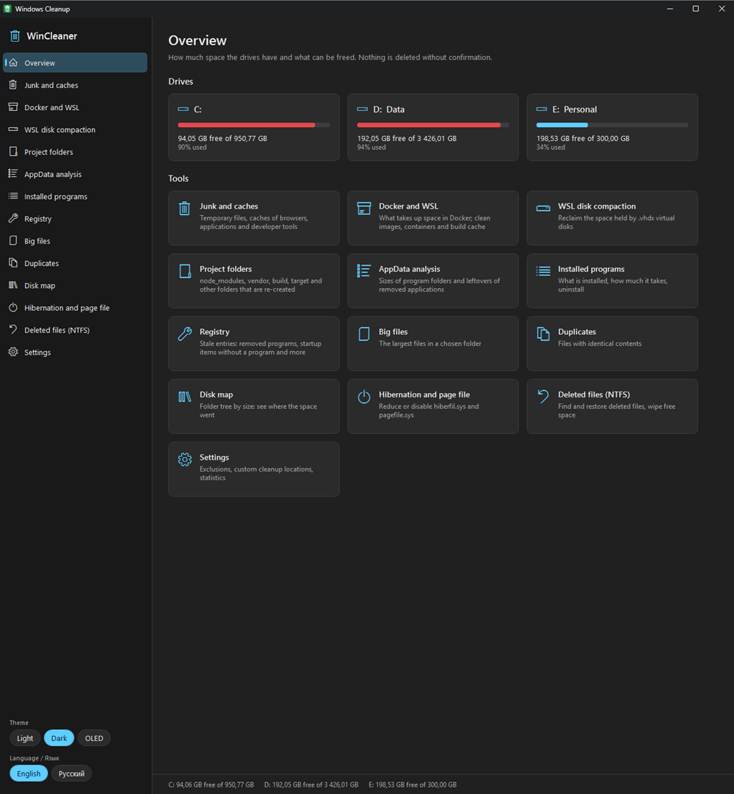

# WinCleaner

A small, dependency-free Windows disk cleanup utility. It finds what is eating your disk — system junk, browser and
developer caches, AI tool caches and models, Docker/WSL virtual disks, build folders, leftovers of uninstalled
programs, huge files — and removes only what you tick. It can also resize the hibernation and page files and look for
deleted files on NTFS volumes.

[](docs/images/origin.png)

*Overview page, dark theme. Click the image for the full-size screenshot.*

- Single self-contained exe, no installer, no runtime to download.
- Built with the C# compiler that already ships with Windows (.NET Framework 4.x) — no Visual Studio or SDK needed.
- Nothing is deleted without an explicit confirmation dialog that lists what will be removed.
- English interface by default, switchable to Russian.
- Modern interface (WPF): sidebar navigation, overview page with drive cards, light, dark and OLED (true black) themes.
- Preview of exactly which files will be deleted, an exclusion list and your own cleanup locations.
- Disk map, duplicate finder, installed programs list and optional scheduled auto-clean.

## Requirements

- Windows 10 or 11 (64-bit recommended).
- .NET Framework 4.x — preinstalled on every supported Windows version.
- Administrator rights. The app requests elevation on start (UAC prompt): they are needed to clean system folders,
  read NTFS volumes directly, run `diskpart` and change power/page file settings.

## Build and install

There is nothing to install. Build the executable once and run it:

1. Download or clone this folder.
2. Double-click **`build.cmd`**.
3. `bin\WinCleaner.exe` is created. Run it and accept the UAC prompt.

`build.cmd` calls `csc.exe` from `%WINDIR%\Microsoft.NET\Framework64\v4.0.30319` and compiles everything under `src\`.
The exe is self-contained — copy it anywhere (USB stick, another PC).

If the script says `csc.exe not found`, enable **.NET Framework 4.x** in *Turn Windows features on or off*.

To remove the program, delete the exe. It installs no services. Its settings (language, theme, exclusions, custom
locations, window position, last used folders, statistics) are kept in `HKEY_CURRENT_USER\Software\WinCleaner`; delete
that key to reset them. If you enabled scheduled auto-clean, switch it off first (it is a Task Scheduler task).

## Language and theme

The interface is English by default. The **Language** and **Theme** (light, dark, OLED) switches are at the bottom of the sidebar. The
theme follows the Windows app theme until you choose one. The language cannot be changed while an operation is running.

## Tools

| Tool | What it does |
| --- | --- |
| **Junk and caches** | Scans 165 known locations in 14 groups (full list below), shows the size of each and of every group, and cleans the ticked ones. Groups can be collapsed. |
| **Docker and WSL** | Shows `docker system df` and runs the selected `docker … prune` commands. |
| **WSL disk compaction** | One-click shrink of WSL2 / Docker Desktop virtual disks: optional `docker prune` → `fstrim` → stop Docker and WSL → `diskpart compact vdisk` → start Docker again. Disks in non-standard locations can be added with *Add file…*. |
| **Project folders** | Finds re-creatable folders inside projects: `node_modules`, `vendor`, `build`, `target`, `.gradle`, `.next`, `bin`/`obj`, `.vs`, `__pycache__`, `.pytest_cache`, `.tox`, `.terraform`, Unity `Library`, Unreal `Intermediate`, Symfony `var/cache`, Python venvs … Most are listed only if a matching project file (`package.json`, `composer.json`, `build.gradle`, `*.csproj` …) sits next to them. |
| **AppData analysis** | Sizes of every program folder in `AppData\Local`, `Roaming`, `LocalLow` and `ProgramData`, matched against installed programs and running processes. Folders with no matching program are highlighted as probable leftovers. Deletes to the Recycle Bin by default. |
| **Installed programs** | Entries of the registry *Uninstall* list, each verified against reality: is the uninstaller there, is the MSI package registered, does the drive still exist. Stale entries (the program is gone, the entry remains) are highlighted and can be removed. Size is the real size of the program folder; `≈` marks an installer estimate. |
| **Registry** | Finds registry entries that point to files that do not exist: removed programs still in the installed list, startup items without a program, App Paths, SharedDLLs, the program name cache. Affected keys are exported to `.reg` files before anything is deleted. |
| **Big files** | Lists the largest files under a chosen folder (ISO images, installers, archives, videos). Can be limited to files not touched for N months; *Old downloads* finds stale files in the Downloads folder in one click. |
| **Duplicates** | Finds files with identical contents (size, then a hash of the first 64 KB, then a full hash only for the remaining candidates). Hard links to the same file are not reported. One click ticks everything but the oldest or the newest copy in each group. |
| **Hibernation and page file** | Shows the current size of `hiberfil.sys` / `pagefile.sys` and lets you reduce or disable hibernation and set a fixed page file size (with a recommendation based on real peak usage). |
| **Deleted files (NTFS)** | Reads the MFT of a volume, lists deleted files whose records still exist, estimates whether their data has been overwritten, restores the ticked ones to another drive, and can wipe free space (`cipher /w`). The wipe shows its progress and can be stopped; note that it temporarily fills the drive completely, three times. |
| **Disk map** | Folder tree sorted by size, with the share of the parent folder as a bar and a percentage. Shows where the space went even when it is not "known junk". Sub-folders and the largest files are loaded when a folder is expanded; tick folders and files and send them to the Recycle Bin in one go. |
| **Settings** | Exclusions, custom cleanup locations, all-time statistics. |

Common to all lists: click a column header to sort, double-click a row to open it in Explorer, right-click for a menu
(open, copy path, tick/untick selected). The check box in the list header ticks or unticks **all** rows; the space bar
toggles the selected ones. A tool that is running an operation is marked with `●`; you can keep working in the others
meanwhile. The status bar shows free space per drive and how much has been freed since the app started.

### Preview, exclusions and custom locations

- **Preview** (*Junk and caches* → *Preview…*) lists the exact files the selected locations would delete, largest
  first, without deleting anything. The list can be saved to a text file.
- **Exclusions** (*Settings*) are folders the program never touches: they are not counted in sizes and are not deleted
  by any tool, even when they are inside a location being cleaned. A folder that contains an exclusion cannot be
  deleted as a whole.
- **Custom locations** (*Settings*) are your own junk folders, optionally with a file mask such as `*.log`. They appear
  in *Junk and caches* in their own group, unticked by default, and pass the same safety guard as built-in ones.

### Registry cleanup

The *Registry* tool is deliberately conservative. It reports only entries for which it can **verify** that the file they
point to does not exist on a permanently attached, ready drive — it does not guess at "unused" keys. Entries of removed
programs are listed but not ticked; review them yourself (a program on a disconnected external drive looks the same
as a program whose drive is gone for good). Before deleting, every affected key is exported with `reg export` to
`%LOCALAPPDATA%\WinCleaner\registry-backup\<date_time>\`; double-click a `.reg` file there to restore it. An entry
whose key could not be backed up is not deleted. Cleaning the registry frees practically no disk space — its purpose is
to remove "ghost" entries from Windows lists.

### Scheduled auto-clean

*Settings → Scheduled auto-clean* creates a weekly or monthly task in Windows Task Scheduler that runs

```
WinCleaner.exe --auto-clean
```

Without a window it cleans **only the recommended locations** — the ones ticked by default (caches, logs, temporary
files) — respecting the exclusion list, and appends a report to `%LOCALAPPDATA%\WinCleaner\auto-clean.log`. The task
runs with highest privileges, so there is no UAC prompt. If you move the exe, switch the schedule off and on again so
the task points to the new location. The same switch can be used in your own scripts.

## What can be cleaned

The *Junk and caches* tool knows 165 locations in 14 groups. The middle column is ticked by default: caches, logs and
temporary files that are re-created automatically. The right column is **not** ticked: those items have to be
downloaded or rebuilt afterwards, or they change how the system behaves. A location that does not exist on your PC is
simply not shown.

| Group | Cleaned by default | Optional — not ticked by default |
| --- | --- | --- |
| **Windows — temporary files and caches** | User temporary files<br>Windows temporary files<br>Thumbnail cache (image and video previews)<br>Windows internet cache (INetCache)<br>Store app temporary files<br>Microsoft Store cache<br>DirectX shader cache<br>NVIDIA shader cache<br>AMD shader cache<br>Intel graphics cache | Icon cache<br>Recycle Bin<br>Prefetch<br>Font cache<br>Recent files list |
| **Windows — updates and setup leftovers** | Delivery Optimization cache | Windows Update downloads<br>Previous Windows version (Windows.old)<br>Windows setup leftovers<br>Windows upgrade files (ESD)<br>Old system restore points<br>Installer patch cache ($PatchCache$)<br>Unpacked driver installers<br>Component store cleanup (DISM) |
| **Windows — logs, reports and dumps** | Error reports (WER)<br>Crash memory dumps<br>Windows Update logs<br>Diagnostics and telemetry logs<br>Other Windows logs<br>OneDrive logs | Windows servicing logs<br>Windows Defender scan history |
| **Browsers (cache only — passwords, history and tabs are not touched)** | Google Chrome<br>Microsoft Edge<br>Brave<br>Vivaldi<br>Yandex Browser<br>Chromium<br>Arc<br>Opera / Opera GX<br>Mozilla Firefox<br>LibreWolf / Waterfox / Zen<br>Tor Browser<br>Mozilla Thunderbird | — |
| **Messengers and communication** | Discord<br>Slack<br>Signal<br>Element<br>Skype<br>Microsoft Teams (classic)<br>Microsoft Teams (new)<br>WhatsApp<br>Zoom — logs | Telegram Desktop — media cache |
| **Games and launchers** | Steam — web cache<br>Epic Games Launcher — web cache<br>Battle.net — cache<br>Ubisoft Connect — cache<br>GOG Galaxy — cache<br>NVIDIA app / GeForce Experience — web cache<br>Minecraft — logs and crash reports | Steam — game shader cache<br>Steam — unfinished downloads |
| **Media, graphics and office** | Spotify — music cache<br>Adobe — media cache (Premiere, After Effects)<br>DaVinci Resolve — logs<br>OBS Studio — logs and crash reports<br>VLC — album art cache<br>Figma | Microsoft Office — document cache |
| **Other applications** | Postman<br>Notion<br>Obsidian<br>GitHub Desktop<br>WebView2 in other applications<br>App update installers (Squirrel)<br>Dropbox — cache<br>Java — applet cache | — |
| **Code editors and IDEs** | Visual Studio Code<br>Visual Studio — component cache<br>JetBrains Toolbox — downloads | Visual Studio Code — workspace state and edit history<br>Visual Studio — installer cache<br>JetBrains IDEs — caches and logs<br>Folders of old JetBrains IDE / Android Studio versions<br>JDKs downloaded by IntelliJ (~/.jdks) |
| **Development — packages and dependencies (downloaded again)** | Maven wrapper — distributions<br>NuGet — HTTP cache<br>rustup — downloads and temporary files<br>Scoop — installer cache<br>Chocolatey — temporary files<br>winget — logs and temporary files<br>Electron — downloaded binaries<br>node-gyp — Node headers | npm — cache<br>Yarn — cache<br>pnpm — store<br>Bun — cache<br>Deno — cache<br>Corepack — cache<br>Composer — cache<br>pip / uv — Python cache<br>Poetry — cache<br>Conda — downloaded packages<br>Maven — local repository<br>Gradle — dependency and build cache<br>Gradle — downloaded distributions (wrapper)<br>Ivy / sbt / Coursier — cache<br>JBang — cache<br>NuGet — packages<br>Go — downloaded modules<br>Rust Cargo — downloaded archives<br>Rust Cargo — unpacked sources and git dependencies<br>vcpkg — cache<br>Conan — cache<br>Dart / Flutter — pub cache<br>Playwright — browsers<br>Cypress — binaries<br>Puppeteer / Selenium — browsers and drivers<br>Shared cache ~/.cache |
| **Development — build, SDKs and tools** | Gradle — daemon logs<br>Kotlin daemon — logs<br>Android — build and SDK cache<br>TypeScript — types cache<br>Symfony CLI — cache | Go — build cache<br>Gradle — automatically downloaded JDKs<br>Kotlin/Native — cache<br>Android — emulator snapshots<br>ccache — cache<br>Bazel — cache<br>Unity — cache<br>Unreal Engine — DerivedDataCache |
| **Development — containers, VMs and infrastructure** | Docker Desktop — logs<br>kubectl — cache | Vagrant — downloaded boxes<br>minikube — cache<br>Terraform — plugin cache |
| **AI — apps and agents (settings and sign-in are not touched)** | Claude Code — temporary files<br>Claude Desktop<br>ChatGPT Desktop<br>Chatbox<br>Jan<br>AnythingLLM<br>Msty<br>LM Studio<br>Ollama — logs and downloaded updates<br>Cursor<br>Windsurf<br>Kiro<br>Antigravity<br>Trae<br>OpenAI Codex CLI — temporary files<br>Gemini CLI — temporary files<br>Qwen Code — temporary files<br>Aider — cache<br>JetBrains Junie — logs and cache | Claude Code — session history<br>OpenAI Codex CLI — sessions and logs<br>Continue — code index and logs |
| **AI — downloaded models** | — | Ollama<br>LM Studio<br>Jan<br>GPT4All<br>Hugging Face / PyTorch / Whisper |

For browsers and Electron/WebView2 applications only caches and logs are removed — passwords, history, tabs, settings
and sign-in are never touched.

## How it works

- **File scanning** uses the Win32 `FindFirstFileEx` API directly (basic info level, large fetch) with `\\?\` long-path
  support and reads the result buffer manually instead of marshalling a structure per file.
- **Parallel work adapts to the machine.** The number of threads is chosen from the number of CPU cores and the type of
  the drive: up to 8 on an SSD, 2 on a hard disk (1 when file contents are read, as in the duplicate finder), a single
  thread on a single-core system. Sizes of many locations are measured by one shared pool of threads, so one huge
  folder does not hold the others up; deletion of large trees is parallel as well. The log shows the chosen number.
- **Links are never followed.** Junctions and symlinks are not traversed while measuring, and when deleting only the
  link itself is removed, never its target.
- **Safety guard.** Cleanup patterns are checked before use: drive roots, `Windows`, user profile, `AppData`,
  `Program Files`, `ProgramData` and `Users` can never be wiped as a whole.
- **Locked files** are skipped and reported. For a few targets (thumbnail and icon caches) they are scheduled for
  removal at the next reboot.
- **Services** required for a cleanup (Windows Update, BITS, Delivery Optimization, font cache) are stopped for the
  duration and started again only if they were actually running.
- **Docker / WSL disks** are compacted with the built-in `diskpart` (`attach vdisk readonly` → `compact vdisk` →
  `detach vdisk`); a detach is always attempted afterwards, even on failure.
- **NTFS undelete** opens the volume read-only (`\\.\C:`), parses the boot sector, `$MFT` and `$Bitmap` itself and
  never writes to the scanned volume. Parent folders are validated by MFT sequence number, so a file is not shown under
  a folder that merely reuses the same record.
- **Hibernation** is changed through `powercfg`; the **page file** through the `PagingFiles` registry value (takes
  effect after a reboot).

## Safety notes

- The *Junk and caches* and *Project folders* tools delete permanently, bypassing the Recycle Bin. *AppData analysis*
  and *Big files* use the Recycle Bin unless you untick the option.
- Compacting disks shuts down **all** WSL distributions and stops Docker Desktop. Save your work first and do not close
  the app while a disk is being compacted.
- `docker volume prune` and the *volumes* option delete database data stored in unused volumes.
- On SSDs with TRIM the contents of deleted files are usually already zeroed even if the name is still visible. Always
  restore to a **different** drive.
- Use at your own risk and keep backups of anything important.

## Project layout

```
build.cmd                  build script (output: bin\WinCleaner.exe)
LICENSE                    MIT license
docs\
  images\                  screenshots used in this README
assets\
  app.ico                  application icon
  app.manifest             manifest: administrator rights, DPI awareness
src\
  Core\                    all logic, no interface code
    Targets.cs             cleanup locations, their groups and the safety guard
    CleanerEngine.cs       measuring, previewing and cleaning one location
    FileWalker.cs          fast file enumeration, parallel walking, deletion
    DiskTree.cs            disk map: folder tree with sizes
    DuplicateFinder.cs     files with identical contents
    InstalledApps.cs       installed programs: verification of entries, real sizes, uninstallers
    RegistryCleaner.cs     stale registry entries: detection, .reg backup, removal
    AutoClean.cs           windowless cleanup (--auto-clean) and its scheduled task
    ProjectScanner.cs      re-creatable folders inside projects
    AppDataScanner.cs      program folders and leftovers of removed programs
    BigFileScanner.cs      largest files; deleting files and folders
    DockerTools.cs         docker system df / prune
    VhdxTools.cs           WSL / Docker virtual disks: discovery, shutdown, compaction
    SystemFilesInfo.cs     hibernation and page file state and settings
    Ntfs.cs                NTFS reader (MFT, $Bitmap, undelete)
    Wmi.cs                 WMI queries (shadow copies, RAM, page file usage)
    Settings.cs            user settings: exclusions, custom locations, remembered values
    Lang.cs                interface language: Russian -> English string table, saved choice
    Native.cs, Util.cs     Win32 declarations, formatting, running console tools
  Wpf\                     interface
    App.cs                 entry point, light / dark palette
    Theme.xaml             styles and control templates (embedded resource, loaded at start)
    MainWindow.cs          sidebar navigation, overview page
    Controls.cs            list with check boxes and groups, dialogs, small building blocks
    PageBase.cs            common page frame: header, toolbar, log, status, background work
    Pages\                 the tools, the settings page and the preview window
```

The code is deliberately limited to **C# 5**, the newest language version supported by the compiler bundled with
Windows. There is therefore no compiled XAML: styles live in `Theme.xaml`, which is embedded and parsed at start-up,
and page layouts are built in code.

### Translations

Source strings in the code are Russian and wrapped in `L.T("…")`. `src\Core\Lang.cs` holds the table of
Russian → English pairs; when English is selected `L.T` returns the translation, and a string missing from the table is
shown as is. To add a new text, wrap it in `L.T(...)` and add its pair to the table.

## License

The ParameterBundle is open-sourced software licensed under the [MIT license](https://opensource.org/licenses/MIT).
